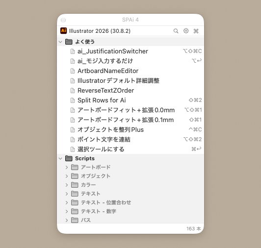
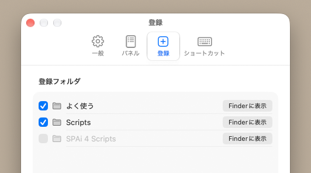
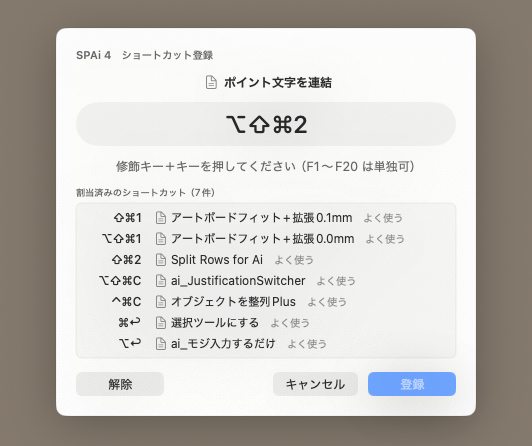
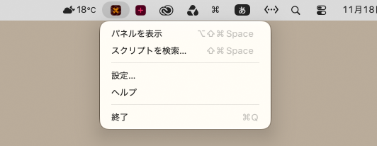

# SPAi 4

macOS用デスクトップアプリ

## ダウンロード

[SPAi-401.zip](https://github.com/monokano/SPAi-4/releases/download/4.0.1/SPAi-401.zip)

## 用途

SPAi 4は、Adobe Illustratorのスクリプトを実行するためのスクリプトパネルです。

**注：Illustratorの中に組み込むパネルではありません。メニューバーやDockに常駐する独立したアプリです。**

- 登録したフォルダ内のスクリプトを階層のままパネルに表示し、ダブルクリックで実行します
- スクリプトにはショートカットを割り当てられます
- クリップボードのテキストを書式なしでペーストする「クリーンペースト」もあります

## 使い方

1. スクリプトが入ったフォルダを登録します
2. Illustratorが最前面のときに、次のどれかの方法で実行します
	- スクリプトパネルでスクリプトをダブルクリック
	- スクリプトに登録したショートカットを押す
	- 検索パレットでスクリプトの名前を入力し、Returnを押す

詳細は、SPAi 4のヘルプメニューから「SPAi 4 ヘルプ」を選択してください。

## 動作環境

macOS 13.5 Ventura以降（Universal Binary）

## ライセンス

This project is licensed under the MIT License - see the [LICENSE](LICENSE) file for details.
